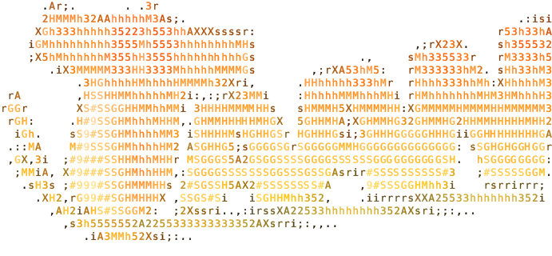

<p align="center">
  
</p>

<h1 align="center">TAAN Backend</h1>

<p align="center">
  <strong>An independent server reconstruction for TAAN 1.929.</strong><br>
  Java 25 · PostgreSQL 18 · Docker Compose
</p>

<p align="center">
  <a href="#quick-start">Quick start</a> ·
  <a href="#commands">Commands</a> ·
  <a href="#channel-types">Channel types</a> ·
  <a href="https://github.com/onitofu/taan-backend/actions/workflows/ci.yml">CI</a>
</p>

## Quick start

Requires Docker with Compose v2 and Make.

```sh
cp .env.example .env
```

Set `POSTGRES_PASSWORD` in `.env`, then start the backend and PostgreSQL:

```sh
make start
```

Default TCP endpoint: `127.0.0.1:2181`. Configuration is in `.env`.

After the first start, configure the channel catalog in PostgreSQL. Migrations create a `Solar` group
with `Moon` and `Terra` channels as defaults. Open a database session:

```sh
docker compose exec postgres sh -c 'psql -U "$POSTGRES_USER" -d "$POSTGRES_DB"'
```

- `channel_groups`: set `name`, `type` and `sort_order`.
- `channels`: link each channel through `group_id`; set its unique `id`, `name`, `kind`, `enabled`,
  `min_level`, `max_level`, `capacity` and `sort_order`. See [channel types](#channel-types).

Exit psql with `\q`, then reload the catalog:

```sh
docker compose restart backend
```

```sh
docker compose logs -f backend
docker compose down
```

`docker compose down` stops the services and preserves database data.

## Commands

| Command | Action |
| --- | --- |
| `make build` | Build the backend Docker image. |
| `make start` | Build and start services in the background. |
| `make clean` | Stop services and **delete the PostgreSQL data volume**. |
| `make checkstyle` | Check Java code style. |
| `make test` | Run tests, including integration tests. |
| `make verify` | Run the full build: `./mvnw clean verify`. |

Maven commands require JDK 25; the Maven Wrapper is included. Tests require Docker for PostgreSQL integration tests.

Reports: `target/surefire-reports/` and `target/site/jacoco/` (HTML/XML).

## Channel types

Channel settings are stored in PostgreSQL. The client uses these numeric categories:

| Value | Group description (`channel_groups.type`) | Ordinary maps (`channels.kind`) |
| --- | --- | --- |
| `0` | Beginner (`BeginnerDesc`) | 1, 2, 4, 9, 10, 17 — 6 maps |
| `1` | Rookie (`RookieDesc`) | 1–12, 15–21 — 19 maps |
| `4` | Veteran (`VeteranDesc`) | 3, 5–8, 11–15, 18–21 — 14 maps |
| `6` | Free channel (`FreeChDesc`) | 1–21 — all 21 maps |

The fields are independent: `channel_groups.type` selects the group description;
`channels.kind` controls map availability. Level restrictions use `channels.min_level` and `channels.max_level`.
Restart the backend after changing these settings.

Map IDs and assets: [map catalog](src/main/resources/match/maps.csv).
